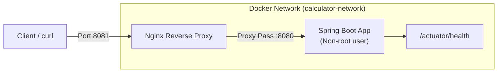

# End-to-End CI/CD Pipeline for a Calculator REST API


[](https://openjdk.org/)
[](https://spring.io/projects/spring-boot)
[](https://www.docker.com/)
[](https://docs.docker.com/compose/)
[](https://nginx.org/)
[](https://www.jenkins.io/)

A production-style Calculator REST API built with Java and Spring Boot, packaged with a complete, automated DevOps CI/CD pipeline using GitHub, Jenkins, Docker, and Docker Compose with an Nginx reverse proxy.

---

## Features

- **RESTful Arithmetic Operations:** Addition, subtraction, multiplication, and division with floating-point support.
- **Robust Input Validation:** Standardized JSON error response with HTTP 400 for division by zero and invalid or missing parameters.
- **Health Monitoring:** Integrated Spring Boot Actuator endpoint (`/actuator/health`) for orchestrator probes.
- **Reverse Proxy Routing:** Nginx reverse proxy routing traffic to the backend service with separate health checking.
- **Multi-Stage Containerization:** Minimal Alpine JRE runtime executed under a dedicated non-root user (`appuser`).
- **Resilient CI/CD:** Declarative Jenkins pipeline featuring automated tests, Docker Hub publishing, zero-downtime container updates, health verification, automated rollback on failure, and HTML email status notifications.

---

## Architecture



### CI/CD Workflow

```
[Git Push] ➔ [GitHub Webhook] ➔ [Jenkins Pipeline]
  ├── 1. Preflight Environment Check
  ├── 2. SCM Checkout
  ├── 3. Maven Build & JAR Archival
  ├── 4. Unit & Integration Tests (JUnit Reports)
  ├── 5. Code Coverage Report (JaCoCo)
  ├── 6. Multi-Stage Docker Image Build
  ├── 7. Docker Hub Push (Isolated Credentials)
  ├── 8. Zero-Downtime Deployment (Docker Compose)
  ├── 9. Live Endpoint Smoke Testing & Health Verification
  └── 10. Automated Rollback on Failure & Status Email Alerts
```

---

## API Specification

The API accepts GET requests with query parameters `a` and `b` (floating-point numbers).

| Operation | Endpoint | Method | Query Parameters | Description |
| :--- | :--- | :---: | :--- | :--- |
| **Add** | `/api/v1/add` | `GET` | `a`, `b` | Returns $a + b$ |
| **Subtract** | `/api/v1/subtract` | `GET` | `a`, `b` | Returns $a - b$ |
| **Multiply** | `/api/v1/multiply` | `GET` | `a`, `b` | Returns $a \times b$ |
| **Divide** | `/api/v1/divide` | `GET` | `a`, `b` | Returns $a / b$ (HTTP 400 if $b = 0$) |
| **Health** | `/actuator/health` | `GET` | _None_ | Application health status (`UP`/`DOWN`) |
| **Proxy Health** | `/nginx-health` | `GET` | _None_ | Nginx reverse proxy health status |

### Sample Requests & Responses

#### Addition
```bash
curl -s "http://localhost:8081/api/v1/add?a=10.5&b=4.5"
```
```json
{
  "operation": "add",
  "a": 10.5,
  "b": 4.5,
  "result": 15.0
}
```

#### Division
```bash
curl -s "http://localhost:8081/api/v1/divide?a=20&b=4"
```
```json
{
  "operation": "divide",
  "a": 20.0,
  "b": 4.0,
  "result": 5.0
}
```

#### Error Handling (Division by Zero)
```bash
curl -i "http://localhost:8081/api/v1/divide?a=10&b=0"
```
```http
HTTP/1.1 400 Bad Request
Content-Type: application/json
```
```json
{
  "error": "DIVISION_BY_ZERO",
  "message": "Cannot divide by zero"
}
```

#### Health Probe
```bash
curl -s "http://localhost:8081/actuator/health"
```
```json
{
  "status": "UP"
}
```

---

## Getting Started

### Prerequisites

- **Java Development Kit (JDK):** Version 21
- **Maven:** Version 3.9+ (or use the included `./mvnw`)
- **Docker:** Version 24+ & Docker Compose v2+
- **Git**

### 1. Run Locally with Maven

Clone the repository and start the application:

```bash
git clone https://github.com/navaneeth-d/SPE_MiniProject_Calculator.git
cd SPE_MiniProject_Calculator

# Run tests
./mvnw clean test

# Run application
./mvnw spring-boot:run
```

The application will start on port `8080`. You can access it directly at `http://localhost:8080/actuator/health`.

### 2. Run with Docker Standalone

Build and run the containerized application independently:

```bash
# Build image
docker build -t calculator-app:latest .

# Run container
docker run -d --name calculator -p 8080:8080 calculator-app:latest

# Check status
docker ps
curl http://localhost:8080/actuator/health
```

### 3. Run with Docker Compose (Recommended)

Run the full production stack comprising the Spring Boot application and the Nginx reverse proxy:

```bash
# Start all services in the background
docker compose up -d --build

# View service status and health checks
docker compose ps

# View logs
docker compose logs -f

# Test via Nginx ingress (Port 8081)
curl http://localhost:8081/actuator/health
curl "http://localhost:8081/api/v1/add?a=15&b=25"

# Stop and remove containers
docker compose down
```

---

## Testing & Quality Assurance

The test suite includes unit tests, web layer integration tests, and exception handling tests:

- **Unit Tests (`CalculatorServiceTest`):** Exercises arithmetic operations, boundary conditions, floating-point precision, IEEE 754 infinity overflow, zero handling, and divide-by-zero exceptions.
- **Integration Tests (`CalculatorControllerTest`):** Uses Spring MVC `MockMvc` to validate endpoint routing, response schemas, parameter validation, and HTTP 400 handling.
- **Context Sanity (`CalculatorApplicationTests`):** Verifies the Spring application context loads properly.
- **Code Coverage:** Configured with the JaCoCo Maven plugin.

Execute all tests:
```bash
./mvnw clean test
```

Generate JaCoCo code coverage report:
```bash
./mvnw jacoco:report
```
The HTML report is saved in `target/site/jacoco/index.html`.

---

## CI/CD Pipeline Configuration

The automated pipeline is defined in `Jenkinsfile`.

### Jenkins Setup Requirements

1. **Plugins:**
   - Pipeline
   - Git & GitHub Integration
   - Credentials Binding
   - JUnit
   - Mailer / Email Extension

2. **Credentials Configuration:**
   - **Docker Hub:** Add credentials of type *Username with password* with ID `dockerhub_credentials`.
   - **Notification Email:** Add a *Secret text* credential with ID `notification_email` storing the destination email address.

3. **Pipeline Job:**
   - Create a new Pipeline job pointing to the GitHub repository.
   - Configure SCM with the `main` branch and script path `Jenkinsfile`.
   - Enable GitHub webhook trigger (`githubPush()`).

---

## Repository Structure

```
SPE_MiniProject_Calculator/
├── Dockerfile                  # Multi-stage build (builder + Alpine JRE runtime)
├── Jenkinsfile                 # Declarative CI/CD pipeline
├── docker-compose.yml          # Multi-container orchestration (App + Nginx)
├── pom.xml                     # Maven dependencies, plugins, and JaCoCo config
├── mvnw / mvnw.cmd             # Maven Wrapper scripts
├── .dockerignore               # Docker context exclusion rules
├── .gitignore                  # Git tracking exclusion rules
├── nginx/
│   └── default.conf            # Nginx reverse proxy configuration & health endpoint
└── src/
    ├── main/
    │   ├── java/com/example/calculator/
    │   │   ├── CalculatorApplication.java
    │   │   ├── controller/CalculatorController.java
    │   │   ├── service/CalculatorService.java
    │   │   ├── model/
    │   │   │   ├── CalculationResponse.java
    │   │   │   └── ErrorResponse.java
    │   │   └── exception/
    │   │       ├── DivisionByZeroException.java
    │   │       └── GlobalExceptionHandler.java
    │   └── resources/
    │       └── application.properties
    └── test/
        └── java/com/example/calculator/
            ├── CalculatorApplicationTests.java
            ├── CalculatorControllerTest.java
            ├── CalculatorServiceTest.java
            └── GlobalExceptionHandlerTest.java
```